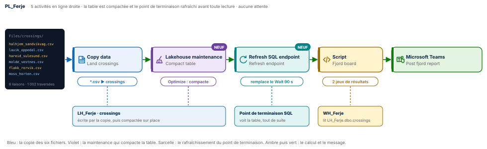
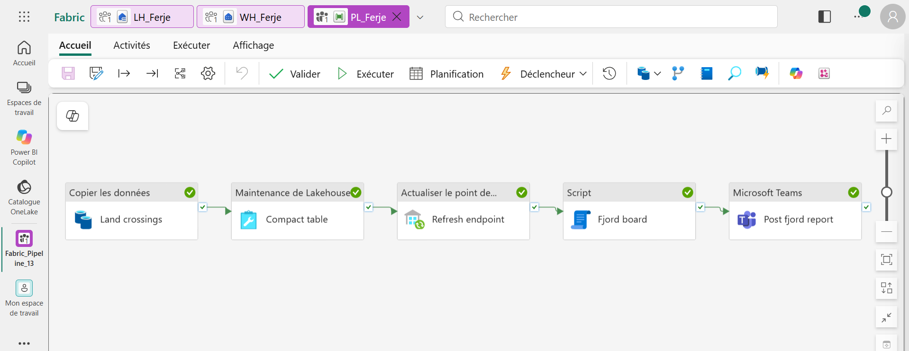
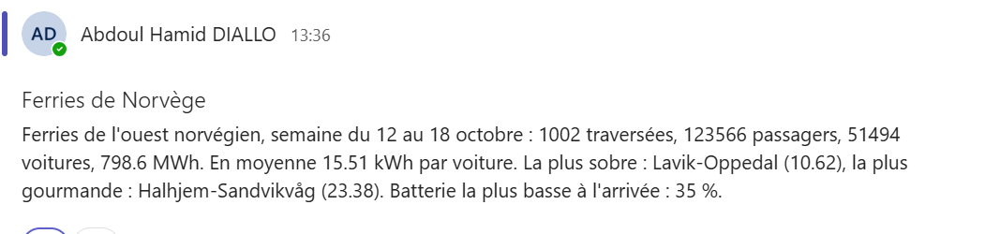
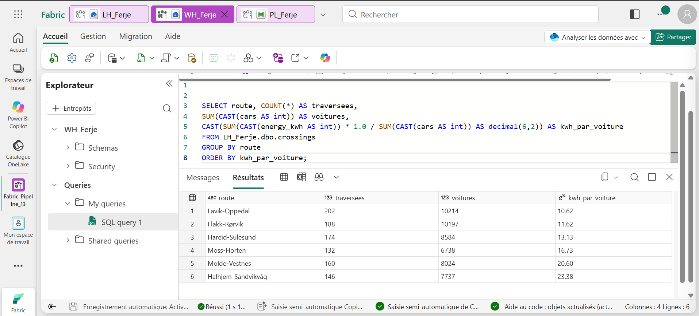
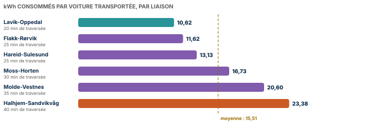

# ⛴️ Fabric Pipeline Express 13 : un pipeline qui range derrière lui




Un pipeline Microsoft Fabric Data Factory qui charge une semaine de traversées des ferries électriques de l'ouest de la Norvège. Les six liaisons envoient chacune leur fichier CSV. Une seule copie les charge tous grâce à un chemin générique, puis le pipeline **fait le ménage lui-même** : la **maintenance du lakehouse** compacte la table, et le **rafraîchissement du point de terminaison SQL** rend les nouvelles lignes visibles tout de suite. Le Script lit donc une table propre et à jour, sans aucune attente. Il mesure l'énergie consommée par voiture transportée, et Teams publie le bilan.

**Guide PDF de 7 pages inclus** : [`Pipeline_Fabric_Guide_13_public.pdf`](Pipeline_Fabric_Guide_13_public.pdf). Chaque écran, chaque réglage, chaque expression, et les chiffres à retrouver à l'unité près. Les valeurs à copier sont dans [`data/expressions.txt`](data/expressions.txt) et les requêtes commentées dans [`sql/`](sql).

## 📸 Aperçu

`PL_Ferje` après une exécution réussie : cinq activités en ligne droite, de la copie jusqu'à Teams, sans aucune activité Wait.



Le bilan publié dans Microsoft Teams, construit à partir des deux résultats du Script.



La requête de contrôle dans l'entrepôt : une ligne par liaison, de la plus sobre à la plus gourmande.



## 🎯 Résultats clés

| Indicateur | Valeur |
|---|---|
| Activités | 5 (Copy data, Lakehouse maintenance, Refresh SQL analytics endpoint, Script, Microsoft Teams) |
| Nouveautés | Activité Lakehouse maintenance (Optimize), activité Refresh SQL analytics endpoint, connexion Lakehouse partagée entre deux activités, copie de six fichiers par un chemin générique |
| Traversées chargées | 1 002 sur six liaisons, du 12 au 18 octobre 2026 |
| Passagers et voitures | 123 566 passagers, 51 494 voitures |
| Énergie consommée | 798,6 MWh |
| Moyenne | 15,51 kWh par voiture transportée |
| Liaison la plus sobre | Lavik-Oppedal, 10,62 kWh par voiture |
| Liaison la plus gourmande | Halhjem-Sandvikvåg, 23,38 kWh par voiture, soit 2,2 fois plus |
| Attente avant le Script | 0 seconde |

## 💼 Impact métier

Un exploitant de ferries électriques pilote d'abord une chose : l'énergie. Savoir quelle liaison consomme le plus par voiture, c'est savoir où renforcer la recharge à quai, où adapter la vitesse et quel navire affecter à quelle traversée. Le pipeline livre cette réponse chaque semaine dans Teams. Côté données, il évite deux défauts classiques : la table qui se fragmente au fil des chargements et ralentit les lectures, et le rapport qui lit une table pas encore visible par le point de terminaison SQL. Ici, la table est compactée et le point de terminaison rafraîchi avant toute lecture.

## 📝 Résumé

`PL_Ferje` lit les six fichiers de `Files/crossings` du lakehouse `LH_Ferje` avec un seul motif, `*.csv`, et écrit les 1 002 traversées dans la table `crossings` (action Remplacer, donc rejouable). `Compact table` lance un **Optimize** sur cette table : les petits fichiers Parquet sont fusionnés. `Refresh endpoint` demande au point de terminaison SQL de se mettre à jour, et attend qu'il ait fini. Le Script `Fjord board`, exécuté sur l'entrepôt `WH_Ferje`, lit alors `LH_Ferje.dbo.crossings` et renvoie deux résultats : la semaine en une ligne, puis la liaison la plus sobre et la plus gourmande. `Post fjord report` publie le bilan dans Teams.

## 🔁 Pipeline

| Activité | Type | Rôle |
|---|---|---|
| `Land crossings` | Copy data | Chemin générique `*.csv` dans `crossings`, vers la table `crossings`, action Remplacer |
| `Compact table` | Lakehouse maintenance | Optimize sur `crossings` : regroupe les petits fichiers en quelques gros fichiers |
| `Refresh endpoint` | Refresh SQL analytics endpoint | Force le point de terminaison SQL de `LH_Ferje` à voir la table maintenant |
| `Fjord board` | Script | `resultSets[0]` : la semaine ; `resultSets[1]` : la liaison la plus sobre et la plus gourmande |
| `Post fjord report` | Microsoft Teams | Le bilan de la semaine en une ligne |

## 🧠 Les quatre idées du projet

**Un motif plutôt qu'un nom.** `*.csv` lit tous les fichiers du dossier. Une septième liaison arrive demain ? On dépose son fichier, le pipeline ne change pas.

**Compacter après avoir écrit.** Chaque écriture Delta laisse des fichiers Parquet, et leur accumulation ralentit les lectures. L'activité Lakehouse maintenance lance un Optimize directement depuis le pipeline, sans notebook ni code.

**Demander au lieu d'attendre.** Le point de terminaison SQL voit les nouvelles tables avec un délai. Plutôt qu'une pause de 90 secondes en espérant qu'il soit à jour, l'activité Refresh SQL analytics endpoint le rafraîchit et attend la fin. Le Script lit forcément la table à jour.

**Une connexion, deux activités.** La maintenance et le rafraîchissement exigent une vraie connexion Lakehouse, avec un compte, et pas seulement l'élément lakehouse. Créée une fois, elle n'est liée à aucun lakehouse précis et sert aux deux activités.

## 🚦 Le pipeline en une image

| Étape | Dans une capitainerie | Dans Fabric |
|---|---|---|
| 1 | Les six carnets de bord arrivent au bureau | Six CSV dans `Files/crossings` |
| 2 | Le commis les recopie dans le grand registre | Copy data, chemin générique `*.csv` |
| 3 | Le registre est relié et rangé | Lakehouse maintenance, Optimize |
| 4 | L'index du registre est mis à jour | Refresh SQL analytics endpoint |
| 5 | Le chef d'escale compare l'énergie par voiture | Script à deux résultats |
| 6 | Le bilan est affiché sur le quai | Microsoft Teams |

## 🧬 Traçabilité

```
LH_Ferje / Files / crossings / *.csv        6 fichiers, 1 002 traversées
                         │  Copy data Land crossings (chemin générique, Remplacer)
                         ▼
LH_Ferje.dbo.crossings   crossing_id · route · departed_at · minutes · passengers · cars · energy_kwh · battery_end_pct
                         │  Lakehouse maintenance Compact table (Optimize)
                         ▼
                         │  Refresh SQL analytics endpoint Refresh endpoint (Success ou NotRun)
                         ▼
Script Fjord board sur WH_Ferje
   ├─ resultSets[0]  crossings 1002 · passengers 123566 · cars 51494 · mwh 798.6 · kwh_per_car 15.51 · min_battery 35
   └─ resultSets[1]  best_route Lavik-Oppedal 10.62 · worst_route Halhjem-Sandvikvåg 23.38
                         ▼
Microsoft Teams Post fjord report
```

## 🏗️ Architecture

| Objet Fabric | Type | Rôle |
|---|---|---|
| `LH_Ferje` | Lakehouse, sans schémas | Reçoit les CSV dans `Files/crossings`, porte la table `crossings` |
| `CN_Lakehouse` | Connexion Lakehouse | Compte d'organisation, utilisée par la maintenance et le rafraîchissement |
| `WH_Ferje` | Entrepôt | Exécute le Script et lit le lakehouse par son nom à trois parties |
| `PL_Ferje` | Pipeline | Orchestre la copie, le rangement, le calcul et le message |

Le lakehouse est créé **sans schémas** : l'activité Lakehouse maintenance ne prend pas encore en charge les lakehouses avec schémas.

La seconde requête du Script, qui classe les liaisons par énergie consommée par voiture :

```sql
WITH c AS (SELECT route, CAST(cars AS int) AS cars, CAST(energy_kwh AS int) AS kwh
           FROM LH_Ferje.dbo.crossings),
r AS (SELECT route, CAST(SUM(kwh) * 1.0 / SUM(cars) AS decimal(6,2)) AS kwh_per_car
      FROM c GROUP BY route)
SELECT (SELECT TOP 1 route FROM r ORDER BY kwh_per_car ASC)  AS best_route,  MIN(kwh_per_car) AS best_kwh,
       (SELECT TOP 1 route FROM r ORDER BY kwh_per_car DESC) AS worst_route, MAX(kwh_per_car) AS worst_kwh
FROM r;
```

L'énergie totale est divisée par le nombre total de voitures, liaison par liaison : une traversée longue consomme plus, mais c'est l'efficacité par voiture qui permet de comparer les liaisons entre elles.

## 📊 Résultat final



| Liaison | Durée | Traversées | Voitures | kWh par voiture |
|---|---|---|---|---|
| **Lavik-Oppedal** | 20 min | 202 | 10 214 | **10,62** |
| Flakk-Rørvik | 25 min | 188 | 10 197 | 11,62 |
| Hareid-Sulesund | 25 min | 174 | 8 584 | 13,13 |
| Moss-Horten | 30 min | 132 | 6 738 | 16,73 |
| Molde-Vestnes | 35 min | 160 | 8 024 | 20,60 |
| Halhjem-Sandvikvåg | 40 min | 146 | 7 737 | 23,38 |

## 📦 Jeu de données

```
data/
├── crossings/
│   ├── flakk_rorvik.csv          188 traversées
│   ├── halhjem_sandvikvag.csv    146 traversées
│   ├── hareid_sulesund.csv       174 traversées
│   ├── lavik_oppedal.csv         202 traversées
│   ├── molde_vestnes.csv         160 traversées
│   └── moss_horten.csv           132 traversées
└── expressions.txt               toutes les valeurs du guide, prêtes à copier
```

Chaque traversée porte `crossing_id`, `route`, `departed_at`, `minutes` (durée de la traversée), `passengers`, `cars`, `energy_kwh` (électricité consommée) et `battery_end_pct` (batterie restante à l'arrivée). Données fictives, conçues pour l'exercice et reproductibles avec [`tools/generate_dataset.py`](tools/generate_dataset.py) ; [`tools/expected_results.py`](tools/expected_results.py) recalcule les résultats attendus.

## 🚀 Reproduire l'exercice

1. Créer un lakehouse `LH_Ferje` **sans schémas**, un dossier `Files/crossings`, y déposer les six CSV. Créer un entrepôt `WH_Ferje`.
2. Créer `PL_Ferje`. Copy data `Land crossings` : chemin générique `*.csv`, texte délimité avec en-tête, vers la table `crossings`, action Remplacer. Exécuter : 6 fichiers, 1 002 lignes.
3. Ajouter Lakehouse maintenance `Compact table` (Optimize sur `crossings`) puis Refresh SQL analytics endpoint `Refresh endpoint`, avec une connexion Lakehouse en compte d'organisation pour les deux.
4. Ajouter le Script `Fjord board` sur `WH_Ferje` avec [`sql/01_fjord_board.sql`](sql/01_fjord_board.sql), puis Teams.
5. Exécuter : cinq activités vertes, aucune attente, le bilan arrive dans Teams.

## 📂 Structure du dépôt

```
fabric-pipeline-express-13/
├── README.md
├── Pipeline_Fabric_Guide_13_public.pdf    le guide de 7 pages
├── data/
│   ├── crossings/                         les six fichiers de la semaine
│   └── expressions.txt                    toutes les valeurs à copier
├── sql/
│   ├── 01_fjord_board.sql                 les deux requêtes du Script
│   └── 02_controle.sql                    une ligne par liaison
├── tools/
│   ├── generate_dataset.py                régénère les six CSV
│   └── expected_results.py                recalcule les résultats attendus
└── images/
    ├── pipeline_diagram.svg               le schéma du pipeline
    ├── energy_by_route.svg                l'énergie par voiture, par liaison
    ├── pipeline_run.png                   PL_Ferje après une exécution réussie
    ├── teams_message.png                  le bilan dans Microsoft Teams
    └── controle_sql.png                   la requête de contrôle
```

## 🧰 Stack technique

Microsoft Fabric Data Factory · Copy data et chemin générique · Lakehouse maintenance (Optimize) · Refresh SQL analytics endpoint · Connexion Lakehouse · Script à plusieurs résultats · Warehouse et T-SQL · Lakehouse et Delta · Microsoft Teams

## ✅ Conclusion

Charger ne suffit pas : une table utile est une table rangée et visible. Ce pipeline charge six fichiers en une copie, compacte la table, rafraîchit le point de terminaison SQL, puis seulement calcule et prévient. Cinq activités, aucune attente, aucun code Spark, et une réponse nette au bout : sur les fjords norvégiens, une voiture coûte 2,2 fois plus d'énergie sur Halhjem-Sandvikvåg que sur Lavik-Oppedal.

## 💭 Dernier mot

Un bon pipeline ne laisse pas de désordre derrière lui. Il range, il rafraîchit, et seulement ensuite il répond.

---

Abdoul Hamid Diallo · Microsoft Data & AI Engineer · Microsoft Certified DP-600, DP-700, PL-300, AI-102, DP-100, AI-900, DP-900 · [LinkedIn](https://www.linkedin.com/in/abdoul-hamid-diallo-fabric-data-engineer/)
